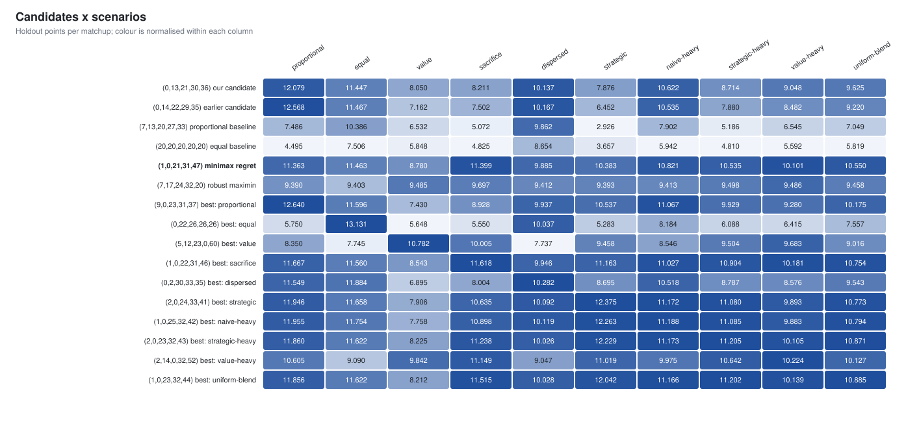
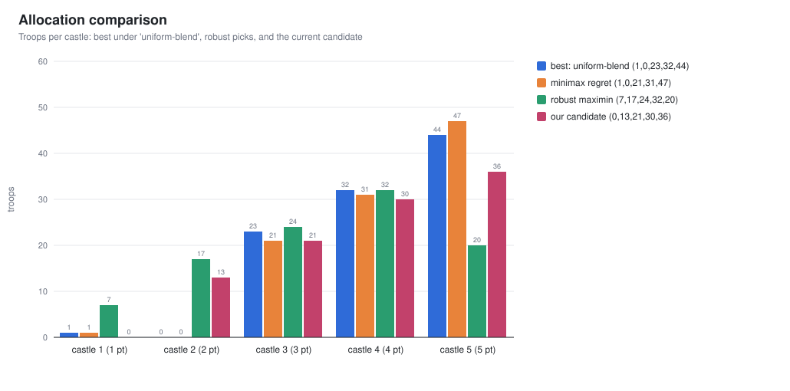
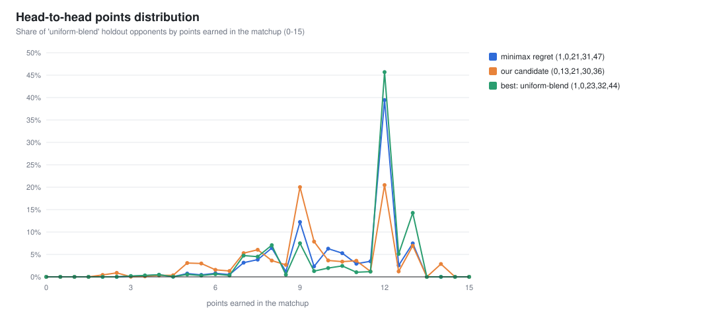
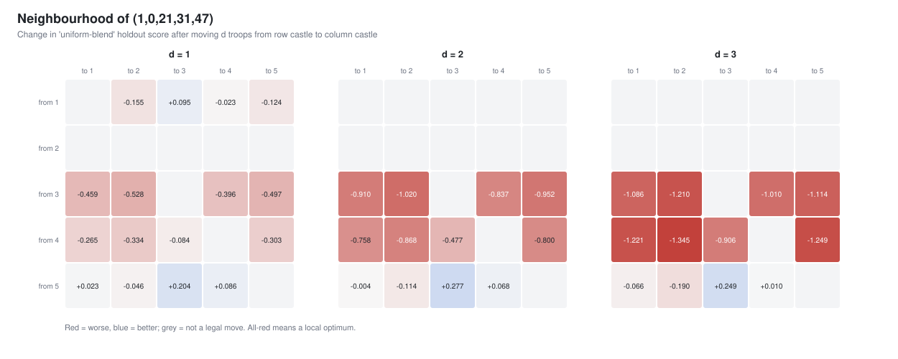

# Game 1: Weighted Colonel Blotto, head to head

> [!NOTE]
> **Where I landed:** submit **(1,0,21,31,47)**. Across ten modelled opponent fields it has the
> smallest worst-case gap to each field's best answer, and the same pick came out on six seeds.
> If you'd rather take a higher average with a worse worst case, **(0,0,22,31,47)** is the
> alternative.

This is the thought process behind that answer: how I framed the problem, the tools I built, what
the data showed, and the decisions I made along the way. The technical reference for the code is
in [README.md](README.md).

**Contents**

1. [The problem](#1-the-problem)
2. [How I framed it](#2-how-i-framed-it)
3. [Modelling the field](#3-modelling-the-field)
4. [The engine](#4-the-engine)
5. [What the data showed](#5-what-the-data-showed)
6. [Where I landed](#6-where-i-landed)
7. [Reproduce](#7-reproduce)

---

## 1. The problem

| | |
| --- | --- |
| **Resources** | 100 soldiers, whole numbers only |
| **Castles** | five, worth 1, 2, 3, 4 and 5 points (15 in total) |
| **A matchup** | the side with more soldiers takes the castle; a tie splits it |
| **Scoring** | my submission plays every other applicant; my score is my **average points per matchup** |

Two facts from the rules shape everything that follows:
- In any matchup the two players' points add up to 15, so 7.5 is break-even.
- The score is **average points**, not the number of matchups won. A narrow loss that still takes
  castles 3 and 4 counts for a lot.

## 2. How I framed it

**There is no "correct" allocation, only a correct one for a given field.** Blotto has no pure
strategy that wins against everyone: for any allocation, a counter beats it by sending one extra
soldier to the right castles. So the question isn't "what's optimal?" but "what scores well against
the people who will actually enter, given that I don't know who they are?"

That led to three decisions:

1. **Model the field explicitly, with several competing hypotheses.** I never blended them into
   one guess. Each opponent type is scored on its own, and then in clearly labelled mixes.
2. **Optimize exactly, so any disagreement comes from the assumptions, not the search.** If two
   scenarios recommend different allocations, I want that to reflect the field, not a heuristic
   that got stuck.
3. **Prefer robustness over a single best guess.** Pick the allocation that does acceptably in
   every plausible field, and measure what that costs.

## 3. Modelling the field

I built six types of applicant. Each is a hypothesis about how people might play, not data.

| Type | What they submit | Why it's plausible |
| --- | --- | --- |
| proportional | close to (7,13,20,27,33) | the "obvious" answer: troops in proportion to value |
| equal | close to (20,20,20,20,20), often round numbers | the simplest possible answer |
| value | weights `value^α` with α between 1.5 and 3 | leans harder into the valuable castles |
| sacrifice | castle 1 at 0–5, the rest weighted by value | gives up the cheapest castle |
| dispersed | random splits, from even to very lopsided | the long tail of unusual entries |
| strategic | small variations on known strong picks | people who read the same analysis and crowd together |

Every generated allocation is checked to be five non-negative whole numbers summing to 100. On top
of the six pure types, I defined four labelled mixes: **naive-heavy**, **strategic-heavy**,
**value-heavy** and **uniform-blend**. That gives ten scenarios in total.

## 4. The engine

### The key observation: castles score independently

Because the score is an *average of points*, my expected score against a pool of opponents splits
castle by castle. For each castle `i` and each troop count `k`, I precompute:

```
M[i][k] = value_i × ( share of opponents with fewer than k troops on castle i
                      + ½ × share with exactly k )
```

My expected score for an allocation `x` is then just `M[1][x₁] + M[2][x₂] + … + M[5][x₅]`. That's
exact for the pool, and it replaces 50,000 matchups with five table lookups.

### Three tools built on that table

| Tool | What it does |
| --- | --- |
| **Dynamic programming** | the exact best allocation against one opponent pool |
| **Exhaustive search** | scores **all 4,598,126 legal allocations** against all ten scenarios at once |
| **Fictitious play** | approximates a mixed-strategy equilibrium as a game-theory benchmark |

The exhaustive search gives two exact robust picks:
- **maximin:** the allocation with the highest worst-case score across scenarios;
- **minimax regret:** the allocation with the smallest worst-case gap to each scenario's own best
  score. I trust this one more, because scenarios differ a lot in how many points are available.

### Guarding against fooling myself

```
for each scenario × 5 repeats:
    training pool (50k opponents) ──► pick allocations ──► score on a fresh holdout pool (50k)
then: 6 independent seeds of the whole pipeline
```

- **Holdout pools.** An allocation picked on one sample is flattered by that sample, so every
  reported score comes from a separate sample.
- **Same opponents for every candidate.** Differences between candidates aren't drowned in noise.
- **Tests (4,681 checks).** They cover:
  - the three hand-worked sanity matchups from the brief;
  - that the two players' points sum to 15, checked on 200,000 random pairs;
  - that every generator produces legal allocations;
  - that the dynamic programming matches brute force on small games;
  - that the exhaustive search visits exactly C(104,4) allocations.

The whole run (100 opponent pools, five exhaustive searches, fictitious play) takes **about
0.7 seconds**.

## 5. What the data showed

### 5.1 Every field has a different best answer

The first thing I checked was how much the answer depends on the field. A lot:



Each row is a candidate allocation and each column a scenario. Color is normalized within each
column, so dark means "good for this field". The `best: …` rows are each scenario's exact best
answer, and each one is dark in its own column and noticeably lighter elsewhere.
(0,22,26,26,26), the best answer to an all-equal field, is the extreme case: 13.13 there, 5.65 in
the value field.

From `outputs/candidate_matrix.csv`, holdout points per matchup (rounded; benchmark column omitted):

```csv
label,allocation,proportional,equal,value,sacrifice,dispersed,strategic,naive-heavy,strategic-heavy,value-heavy,uniform-blend
our candidate,"(0,13,21,30,36)",12.08,11.45,8.05,8.21,10.14,7.88,10.62,8.71,9.05,9.62
earlier candidate,"(0,14,22,29,35)",12.57,11.47,7.16,7.50,10.17,6.45,10.53,7.88,8.48,9.22
proportional baseline,"(7,13,20,27,33)",7.49,10.39,6.53,5.07,9.86,2.93,7.90,5.19,6.54,7.05
equal baseline,"(20,20,20,20,20)",4.49,7.51,5.85,4.83,8.65,3.66,5.94,4.81,5.59,5.82
minimax regret,"(1,0,21,31,47)",11.36,11.46,8.78,11.40,9.89,10.38,10.82,10.53,10.10,10.55
```

> [!IMPORTANT]
> Sampling error is about ±0.02 points, while one allocation's score moves by several points
> between scenarios. **The assumption about the field matters far more than the number of
> samples.** That's why the rest of the analysis focuses on robustness.

### 5.2 How the leading allocations fare against each type


The bar chart shows the trade-offs:
- My starting candidate (0,13,21,30,36), in green, is excellent against proportional and equal
  players. It drops to 7.9 against strategic players, who crowd around exactly that allocation.
- The robust pick (blue) is never the best bar in any group, but it is never far from it either.
- The maximin pick (orange) is almost perfectly flat at about 9.4. It's very safe, but it gives up
  1–3 points in most fields, which is too high a price.

### 5.3 The robust pick

The exhaustive search ranks every legal allocation. The top five by each objective, from
`outputs/robust_top.csv` (rounded; maximin rows trimmed):

```csv
objective,rank,allocation,value
minimax_regret,1,"(1,0,21,31,47)",2.008
minimax_regret,2,"(2,0,21,31,46)",2.029
minimax_regret,3,"(0,0,21,32,47)",2.122
minimax_regret,4,"(3,0,21,31,45)",2.129
minimax_regret,5,"(1,0,21,32,46)",2.134
maximin_worst_score,1,"(7,17,24,32,20)",9.392
maximin_worst_score,2,"(7,16,25,32,20)",9.377
```

The minimax-regret top five share a clear shape: **castle 2 empty, about 21 on castle 3, about 31
on castle 4, and 45–47 on castle 5.**



Why this shape works:
- **Give up castle 2.** It's worth only 2 points, and contesting it costs about 13 soldiers. Those
  soldiers go to castle 5, where 47 beats almost every modelled opponent.
- **One soldier on castle 1.** Many strong players leave castle 1 empty. One soldier turns a
  half-point tie into a full point against all of them, for the price of one soldier.
- **21 / 31 on castles 3 and 4.** Just above where the proportional and strategic players
  cluster (20 and 27–30).

### 5.4 Does it hold up?

**Is the score inflated by picking on the same sample?** No. Training and holdout scores agree to
within about 0.005 points. For example, re-optimizing on five independent strategic pools gives
the same answer every time, from `outputs/repeats.csv`:

```csv
scenario,repeat,dp_pick,train,holdout,robust_pick
strategic,0,"(2,0,24,33,41)",12.3762,12.3754,"(1,0,21,31,47)"
strategic,1,"(2,0,24,33,41)",12.3728,12.3672,"(1,0,21,31,47)"
strategic,2,"(2,0,24,33,41)",12.375,12.364,"(1,0,21,31,47)"
strategic,3,"(2,0,24,33,41)",12.3707,12.3718,"(1,0,21,31,47)"
strategic,4,"(2,0,24,33,41)",12.3782,12.3746,"(1,0,21,31,47)"
```

**Does it depend on the seed?** I reran the whole pipeline with five more seeds
(`outputs/seed_comparison.csv`):

```csv
seed,minimax_regret_pick,max_regret,runner_up,maximin_pick,worst_score,repeats_choosing_pick
42,"(1,0,21,31,47)",2.008,"(2,0,21,31,46)","(7,17,24,32,20)",9.392,5/5
1,"(1,0,21,31,47)",1.997,"(2,0,21,31,46)","(7,17,24,32,20)",9.390,5/5
7,"(1,0,21,31,47)",2.018,"(2,0,21,31,46)","(7,17,24,32,20)",9.383,5/5
123,"(1,0,21,31,47)",2.002,"(2,0,21,31,46)","(7,17,24,32,20)",9.384,5/5
2024,"(1,0,21,31,47)",2.006,"(2,0,21,31,46)","(7,17,24,32,20)",9.391,5/5
99999,"(1,0,21,31,47)",2.012,"(2,0,21,31,46)","(7,17,24,32,20)",9.393,4/5
```

The same pick won on every seed, and in 29 of the 30 independent repeats inside those runs. Averaged
over the six seeds, here is how it compares with my starting candidate:

| Scenario | (1,0,21,31,47) | (0,13,21,30,36) | Difference |
| --- | --- | --- | --- |
| sacrifice | 11.40 | 8.22 | **+3.18** |
| strategic | 10.39 | 7.88 | **+2.50** |
| strategic-heavy | 10.53 | 8.71 | +1.82 |
| value-heavy | 10.10 | 9.05 | +1.05 |
| uniform-blend | 10.55 | 9.64 | +0.91 |
| value | 8.78 | 8.05 | +0.74 |
| naive-heavy | 10.82 | 10.62 | +0.20 |
| equal | 11.46 | 11.44 | +0.02 |
| dispersed | 9.89 | 10.14 | −0.25 |
| proportional | 11.37 | 12.08 | **−0.71** |

Every per-scenario number varies by 0.012 points or less across seeds.

### 5.5 What a typical matchup looks like



Against the uniform-blend field, the robust pick (blue) scores **exactly 12 points in about 39% of
matchups**: it wins castles 3, 4 and 5 and concedes 1 and 2. My starting candidate (orange) splits
its mass between 9 and 12 and has a longer tail of bad results. The distribution makes the strategy
concrete: lock up the top three castles as often as possible.

### 5.6 Fine-tuning: where should each soldier go?

I checked whether moving a few soldiers around the robust pick would help. Each cell is the change
in uniform-blend score after moving `d` soldiers from one castle to another:



Two moves help *in this particular field*: castle 5 → castle 3 (+0.20) and castle 1 → castle 3
(+0.09). That's expected. The robust pick isn't tuned to any single field, so in any one field some
local move usually helps. The real question is whether a move helps everywhere.

So I tested every destination for the castle 1 soldier across all ten scenarios and six seeds
(`outputs/castle1_moves.csv`, selected rows):

```csv
scenario,"current (1,0,21,31,47)","to castle 2 (0,1,21,31,47)","to castle 3 (0,0,22,31,47)","to castle 4 (0,0,21,32,47)","to castle 5 (0,0,21,31,48)"
proportional,11.373,11.372,11.672,11.412,11.372
value,8.782,8.516,8.546,8.675,8.785
strategic,10.386,10.016,10.726,10.397,9.949
uniform-blend,10.550,10.394,10.644,10.525,10.427
mean,10.528,10.364,10.622,10.502,10.402
worst,8.782,8.516,8.546,8.675,8.785
```

Moving it to castle 3 raises the average by about 0.09, because 22 beats the many opponents sitting
at 20–21. But it costs 0.24 against value-weighted players, the field where the pick is already
weakest. **It's a genuine trade-off between average and worst case**, so I kept the hedge and
noted (0,0,22,31,47) as the alternative.

### 5.7 Stress tests and the equilibrium benchmark

Any fixed allocation can be beaten by a counter built against it. I measured how badly, and
reported it separately rather than mixing counters into the opponent fields
(`outputs/adversarial.csv`, some columns omitted):

```csv
label,allocation,direct_counter,score_vs_direct_counter,crowd_counter,score_vs_crowd_counter
minimax regret,"(1,0,21,31,47)","(19,1,0,32,48)",3,"(6,5,0,36,53)",3
our candidate,"(0,13,21,30,36)","(10,0,22,31,37)",2,"(3,0,24,33,40)",2
earlier candidate,"(0,14,22,29,35)","(11,0,23,30,36)",2,"(3,0,25,33,39)",2
```

A targeted counter holds every candidate to 2–3 points. That's not a reason to change the pick:
the counters are poor all-round entries, and someone would have to aim specifically at mine.

I also ran **fictitious play**, which repeatedly best-responds to the mix of everything played so
far, to approximate a mixed-strategy equilibrium. After 5,000 rounds the mixture can be exploited
by only 0.20 points, and it is spread very thinly: no single allocation gets more than 1%. Against
that mixture every leading candidate scores about 7.5. **My edge comes entirely from the field not being
at equilibrium.** That's realistic for a one-shot contest, but it's the assumption the whole
answer rests on.

### 5.8 Ties and crowding

From `outputs/ties.csv` (rounded, selected rows):

```csv
scenario,round_number_share,"tie_points (1,0,21,31,47)","tie_points (0,13,21,30,36)"
proportional,0.0006,0.231,0.831
equal,0.7539,0.063,0.139
strategic,0.081,0.990,2.247
```

My starting candidate earns **2.25 points per matchup from exact ties** against the strategic
field, because that field crowds around it. Ties are half-points, so crowding quietly caps its
score. The robust pick avoids the crowded troop counts.

## 6. Where I landed

| Choice | Allocation | Best for |
| --- | --- | --- |
| **Robust (submitted)** | **(1,0,21,31,47)** | not doing badly in any modelled field; stable across seeds |
| Higher average | (0,0,22,31,47) | a field without many value-weighted players |
| Not recommended | (0,13,21,30,36) | only wins if the field is mostly proportional or random |

What would change my mind: real data about the applicant pool. With even a rough sense of how many
people play proportionally versus strategically, I'd swap the robust objective for a best response
to that estimate.

## 7. Reproduce

```sh
cd Game1
make && make test                       # 4,681 checks
./build/blotto --samples 50000 --seed 42 --scenario all --output outputs/
```

| Output | Contents |
| --- | --- |
| `outputs/*.csv` | every table quoted above |
| `outputs/seed_<N>/` | the five extra seed runs |
| `figures/` | the charts used in this document (copied from `outputs/`) |
