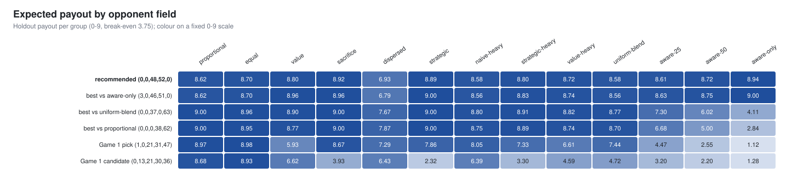
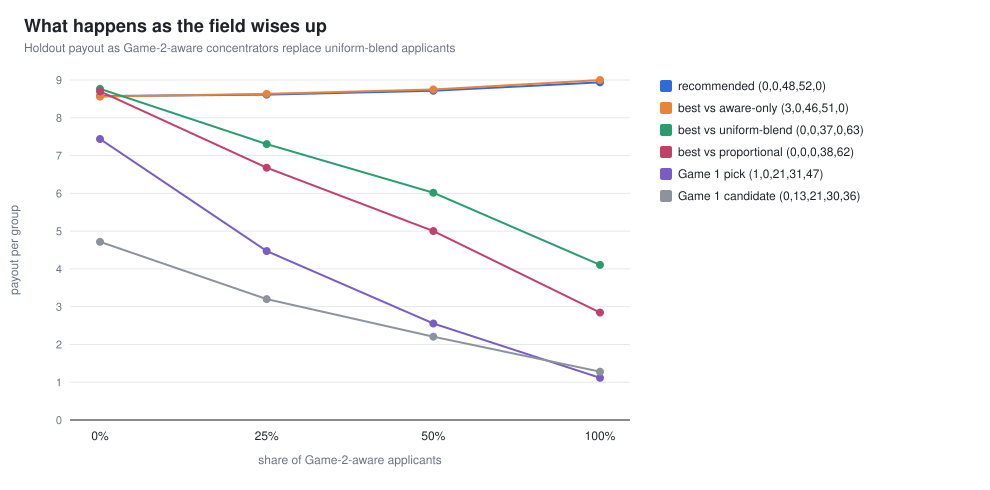
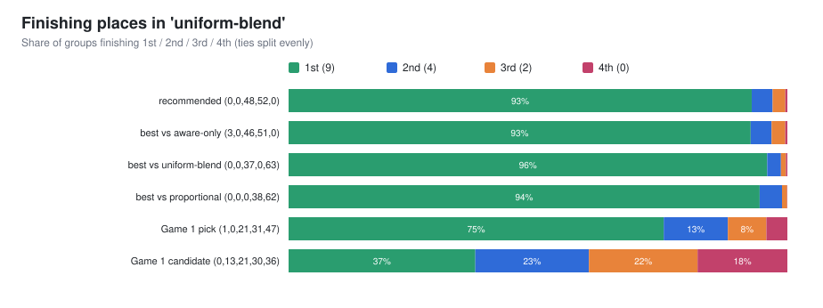
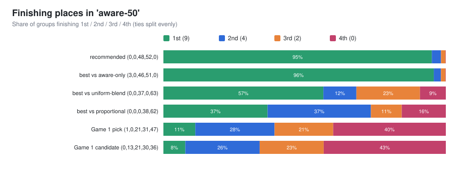
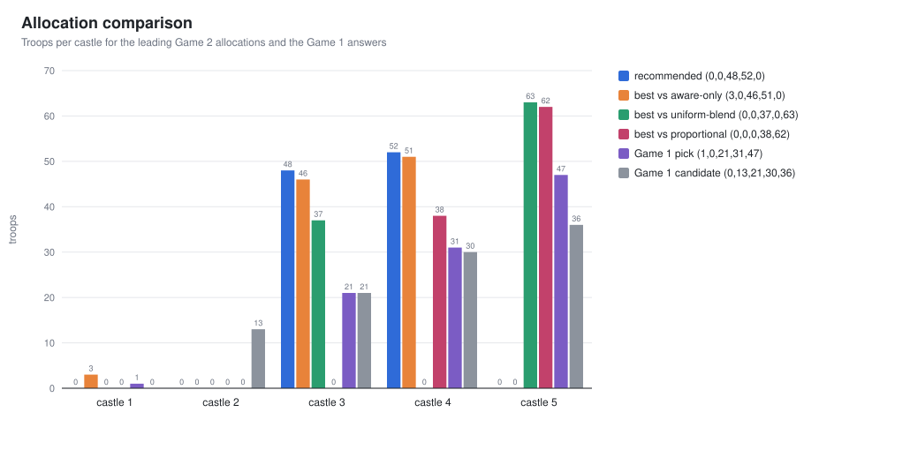

# Game 2: Four-way Blotto

> [!NOTE]
> **Current finding:** **(0,0,48,52,0)**, everything on castles 3 and 4. It has the smallest
> worst-case gap across 13 modelled opponent fields, averages 8.6 out of 9 per group, and finishes
> first about 93% of the time in those models.
>
> **Status: work in progress.** Game 2 is a game of outthinking each other, so this answer depends
> heavily on how other applicants adapt. I'm testing other approaches to see if there are better
> ways to play it (see [section 8](#8-what-im-testing-next)).

This is how I approached Game 2: why my Game 1 machinery didn't carry over, the search I built
instead, the trap the first results fell into, and where things stand. It builds on
[Game 1](../Game1/game1.md); both games share the rules code, random number generator and opponent
models.

**Contents**

1. [The problem](#1-the-problem)
2. [Why the Game 1 approach breaks](#2-why-the-game-1-approach-breaks)
3. [The engine](#3-the-engine)
4. [First result, and the trap in it](#4-first-result-and-the-trap-in-it)
5. [Modelling Game-2-aware players](#5-modelling-game-2-aware-players)
6. [What the data showed](#6-what-the-data-showed)
7. [Why this isn't the final answer](#7-why-this-isnt-the-final-answer)
8. [What I'm testing next](#8-what-im-testing-next)
9. [Reproduce](#9-reproduce)

---

## 1. The problem

| | |
| --- | --- |
| **Resources** | same 100 soldiers, same five castles worth 1–5 points |
| **A round** | I'm placed in a random group of 4; each castle goes to whoever sends the most soldiers, and tied castles split their points |
| **Ranking** | players are ranked by total castle points |
| **Payout** | **only my finish counts:** 1st = 9, 2nd = 4, 3rd = 2, 4th = 0; tied players split the payouts for those places |
| **Score** | groups are reshuffled thousands of times and my payouts are averaged |

The payouts in a group always add up to 15, so the average across all players is **3.75**.

## 2. Why the Game 1 approach breaks

In Game 1 everything rested on one fact: the score is an average of points, so each castle can be
scored on its own. Game 2 breaks that twice:

1. **Winning a castle means beating the highest of three opponents**, not just one. Whether 30
   soldiers on castle 4 is enough depends on all three opponents at once.
2. **The payout depends on rank, not points.** Winning castle 3 matters only if it changes where I
   finish, and that depends on how the other three split the castles I *didn't* win.

So there is no per-castle table and no dynamic programming. Every candidate allocation has to be
played out against many sampled groups. That pushed me towards a search that is both exhaustive
and cheap per group.

> [!IMPORTANT]
> The scoring also changes the strategic picture. Castles 4 and 5 are worth **9 of the 15 points**.
> Win both outright and nobody else can reach 9, so first place is guaranteed. Game 1 rewarded
> spreading out; Game 2 rewards concentration.

## 3. The engine

### Representing a group in 10 bytes

From my seat, all that matters about a group is, for each castle, the opponents' **highest troop
count** and **which of them sent it**. I precompute that once per group. Playing an allocation
against a group then costs a handful of comparisons. Castle points are tracked in twelfths, so
two-, three- and four-way splits stay exact whole numbers.

### Successive halving over all 4.6 million allocations

I didn't want to guess which allocations were worth trying, so each scenario gets a four-stage
search:

```
Stage 1   all 4,598,126 legal allocations × 512 groups      → keep the best 20,000
Stage 2   20,000 survivors              × 8,192 fresh groups → keep the best 500
Stage 3   500 survivors                 × 131,072 groups     → rank
Stage 4   hill-climb from the top 5 (move 1–10 soldiers between castles)
          → recover anything the noisy first stage dropped
Report    every finalist scored on an independent holdout of 200,000 groups
```

Two details keep this honest:
- **Same groups for every candidate within a stage.** Two allocations are compared on identical
  opponents, so the difference between them isn't swamped by noise.
- **Separate holdout groups.** Selection happens on one set of groups and the reported numbers
  come from another, so the winners aren't flattered by the sample that picked them.

Each scenario takes 1.5–3.5 seconds on 10 threads; all 13 take about 25 seconds.

### Tests (191 checks)

- Payouts in every group sum to 15, and castle points sum to 15.
- Hand-worked groups give the right ties. For example, two players tied for first with 4.5 points
  each get (9+4)/2 = 6.5 each.
- The fast evaluator matches a plain implementation of the rules on **300,000 random groups**.
- The exhaustive stage really visits every allocation, and its result doesn't depend on the
  thread count.

## 4. First result, and the trap in it

I first ran the search against the ten opponent fields from Game 1. From `outputs/seed_42.txt`:

```
searched proportional     4598126 allocations, best (0,0,0,38,62) (9.000 on selection groups)
searched equal            4598126 allocations, best (0,0,0,50,50) (9.000 on selection groups)
searched sacrifice        4598126 allocations, best (0,0,0,40,60) (9.000 on selection groups)
searched strategic        4598126 allocations, best (0,0,0,39,61) (9.000 on selection groups)
searched uniform-blend    4598126 allocations, best (0,0,37,0,63) (8.763 on selection groups)
```

A payout of **9.000 means finishing first in every single group**. The search had found that
taking castles 4 and 5 with about 38 and 62 soldiers wins outright, because no Game 1 opponent type
ever sends 63+ to castle 5. Those types were built for head-to-head play, where spreading out pays.

That's a flaw in the opponent model, not a real edge. Anyone who reads the Game 2 rules carefully
will reach the same "take 4 and 5" idea, and the model had none of them. This was the most
important moment in the analysis: **the search always finds the best counter to the field it's
given, so a naive field produces a naive answer.**

## 5. Modelling Game-2-aware players

I added a new, clearly labelled hypothetical opponent: someone who has spotted the concentration
idea and goes all-in on a set of castles worth 8+ points.

| Castles targeted | Points | Share of these players | Typical allocation |
| --- | --- | --- | --- |
| 4 + 5 | 9 | 45% | (0,0,0,30–50,50–70) |
| 3 + 5 | 8 | 25% | (0,0,25–45,0,55–75) |
| 2 + 3 + 4 | 9 | 15% | about (0,22,33,45,0) |
| 2 + 3 + 5 | 10 | 15% | about (0,20,30,0,50) |

About 30% of them also keep 1–3 soldiers on an otherwise empty castle as a hedge. I then built
three new fields alongside the ten from Game 1:

| Field | Composition |
| --- | --- |
| aware-25 | uniform-blend applicants with 25% Game-2-aware players |
| aware-50 | uniform-blend applicants with 50% Game-2-aware players |
| aware-only | 100% Game-2-aware players |

## 6. What the data showed

### 6.1 The full picture



Each row is an allocation and each column a field. The color scale is fixed at 0–9, so it's
comparable across columns. Two things stand out:
- The allocations that were perfect against the Game 1 fields, (0,0,0,38,62) and (0,0,37,0,63),
  fade to light blue as the field becomes Game-2-aware.
- The Game 1 answers do poorly almost everywhere once concentration is in play.

### 6.2 What happens as the field wises up

This is the chart that changed my answer:



- **(0,0,0,38,62)**, the best answer to a naive field, drops from 8.70 to **2.84** as the field
  becomes fully Game-2-aware. Everyone is fighting over castles 4 and 5, and it gets crowded out.
- **(0,0,37,0,63)** holds up better but still falls to 4.11.
- **(0,0,48,52,0)** *rises* from 8.58 to 8.94. The more opponents pile into castle 5, the less
  competition there is for castles 3 and 4.
- **The Game 1 pick (1,0,21,31,47)** falls from 7.44 to 1.12.

From `outputs/results.csv`, the aware-50 field (columns trimmed):

```csv
label,allocation,scenario,holdout_payout,p_first,p_second,p_third,p_fourth
robust maximin / minimax regret,"(0,0,48,52,0)",aware-50,8.716,0.950,0.033,0.016,0.001
#1 naive-heavy / #5 strategic-heavy / #1 uniform-blend,"(0,0,37,0,63)",aware-50,6.016,0.566,0.117,0.225,0.092
#1 proportional,"(0,0,0,38,62)",aware-50,5.002,0.369,0.366,0.109,0.156
Game 1 pick,"(1,0,21,31,47)",aware-50,2.554,0.113,0.281,0.208,0.399
```

### 6.3 How often each allocation finishes where

In a field like Game 1's (uniform-blend), every concentrated allocation wins most of its groups:



Once half the field is Game-2-aware, they separate sharply:



(0,0,48,52,0) still finishes first 95% of the time. (0,0,0,38,62) drops to 37% first and 16% last,
and the Game 1 pick finishes **last 40% of the time**.

### 6.4 Why castles 3 and 4



The logic in steps:
1. Castles 3 and 4 are worth **7 points**. To beat that, a single opponent needs castle 5 *and*
   both castles 1 and 2 (8 points). That's rare, because the other 8 points usually get split
   between three opponents.
2. Game-2-aware players mostly send 50–70 soldiers to castle 5, which leaves them with 30–50
   for everything else. **48 on castle 3 and 52 on castle 4 beat almost all of them.**
3. Skipping castle 5 means never fighting in the most crowded castle. Whoever wins it gets 5
   points, which on its own doesn't beat 7.

The best answer against the fully aware field is a close cousin, (3,0,46,51,0). From
`outputs/finalists.csv`:

```csv
scenario,rank,allocation,selection_payout
aware-50,1,"(3,0,46,51,0)",8.74963
aware-50,2,"(2,0,47,51,0)",8.74411
aware-50,3,"(2,0,46,52,0)",8.74258
aware-only,1,"(3,0,46,51,0)",8.99945
aware-only,2,"(2,1,46,51,0)",8.99548
```

It's the same idea plus a small hedge on castle 1. Overall it averages 8.62 against 8.60 for
(0,0,48,52,0): slightly better against aware fields and slightly worse against dispersed ones.

### 6.5 The weak spot

```csv
label,allocation,scenario,holdout_payout,p_first,p_second,p_third,p_fourth
robust maximin / minimax regret,"(0,0,48,52,0)",dispersed,6.930,0.651,0.212,0.111,0.026
```

The **dispersed** field, with random and often lopsided splits, is where (0,0,48,52,0) is weakest.
A random opponent will now and then send 50+ to castle 3 or 4, and losing either one drops me to 3
or 4 points. Even so, 6.93 is its worst case across all 13 fields, which is better than any
alternative's worst case.

| Allocation | Average over 13 fields | Worst field | Largest gap to a field's best |
| --- | --- | --- | --- |
| **(0,0,48,52,0)** | **8.60** | **6.93** | **1.03** |
| (0,0,37,0,63) | 8.10 | 4.11 | 4.89 |
| (0,0,0,38,62) | 7.86 | 2.84 | 6.16 |
| (1,0,21,31,47), Game 1 pick | 6.56 | 1.12 | 7.88 |
| (0,13,21,30,36), Game 1 candidate | 4.82 | 1.28 | 7.72 |

## 7. Why this isn't the final answer

Game 2 is a contest of levels of reasoning:

```
Level 0   people play like Game 1 (spread out)        → best answer: take castles 4 + 5
Level 1   people take castles 4 + 5 / 3 + 5           → best answer: take castles 3 + 4  ← I am here
Level 2   people take castles 3 + 4 with 48 / 52      → best answer: back to 4 + 5 with 53+ on castle 4, e.g. (0,0,0,53,47) …
```

(0,0,48,52,0) is the best response to *my guess* at what Game-2-aware players will do. It is hard
to beat on its own turf: outbidding both 48 and 52 would take 102 soldiers. But a level-2 player
can go around it by taking castles 4 and 5 with 53+ on castle 4, scoring 9 points to my 3. If
enough applicants reason that far, the cycle turns again. The sampling uncertainty is tiny
(±0.005), but the uncertainty about which level the field is at is large, and it's the only thing
that really matters here.

## 8. What I'm testing next

I'm working on different approaches to see if there are better ways to play Game 2:

- **An adapting field.** Start from these fields, repeatedly let a share of players switch to the
  current best response, and see whether the field settles or cycles. That replaces my hand-made
  Game-2-aware type with one that emerges from the rules.
- **Sensitivity checks** on the share of Game-2-aware players and on which castle sets they target,
  to find where the recommendation flips.
- **Seed repeats**, as in Game 1, to confirm the picks are stable.

## 9. Reproduce

```sh
cd Game2
make && make test                                    # 191 checks
./build/fourway --seed 42 --output outputs           # about 25 s
./build/fourway --scenario aware --candidate 0,0,0,53,47   # test your own idea
```

| Output | Contents |
| --- | --- |
| `outputs/seed_42.txt` | the full terminal report |
| `outputs/results.csv` | every candidate × field: payout, CI, finishing-place shares, castle points |
| `outputs/finalists.csv` | the top 5 per field after the search |
| `figures/` | the charts used in this document (copied from `outputs/`) |
