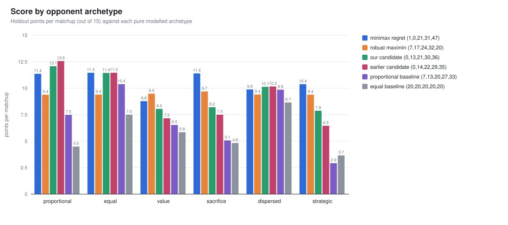

# Colonel Blotto: two castle games

My work on the two castle-allocation games from the poker bot contest run by Sequoia, Citadel and
OpenAI. In both games you split 100 soldiers across five castles worth 1–5 points:

- **Game 1** is head to head. You play every other applicant and score your average castle points
  per matchup.
- **Game 2** is a four-way battle. Only your finish in each group of four counts (9 / 4 / 2 / 0).

## The write-ups

Each game has a write-up with my thought process and a walkthrough of how I approached the
problem: the reasoning, the tools I built, what the numbers showed, and where I landed.

- **[Game 1: head to head](Game1/game1.md)**
- **[Game 2: four-way battle](Game2/game2.md)**

## Current findings

| Game | Current pick | Why |
| --- | --- | --- |
| Game 1 | **(1,0,21,31,47)** | Smallest worst-case gap to the best answer across ten modelled opponent fields; the same pick on six seeds. (0,0,22,31,47) has a slightly higher average but a worse worst case. |
| Game 2 | **(0,0,48,52,0)** | Smallest worst-case gap across 13 modelled fields, including fields where other players also play for Game 2. Averages 8.6 of 9 per group in those models. |

These are my findings so far. They depend on assumptions about how other applicants play, which
the write-ups spell out.

### At a glance

**Game 1:** the robust pick (blue) is never far from the best bar against any opponent type,
while the starting candidates swing widely.



**Game 2:** as more applicants play specifically for Game 2, allocations built for a naive field
collapse, while (0,0,48,52,0) holds up.


Game 2 is still in progress. Its answer depends heavily on how other players adapt, so I'm working
with different approaches and testing them to see if there are better ways to play it.

## Repository layout

| Path | Contents |
| --- | --- |
| [Game1/](Game1/) | Game 1 simulator (C++), tests, outputs; [game1.md](Game1/game1.md) write-up, [README.md](Game1/README.md) technical reference |
| [Game2/](Game2/) | Game 2 simulator (C++), tests, outputs; [game2.md](Game2/game2.md) write-up |

Both simulators need only a C++20 compiler and `make`:

```sh
cd Game1 && make && make test && ./build/blotto
cd Game2 && make && make test && ./build/fourway
```
